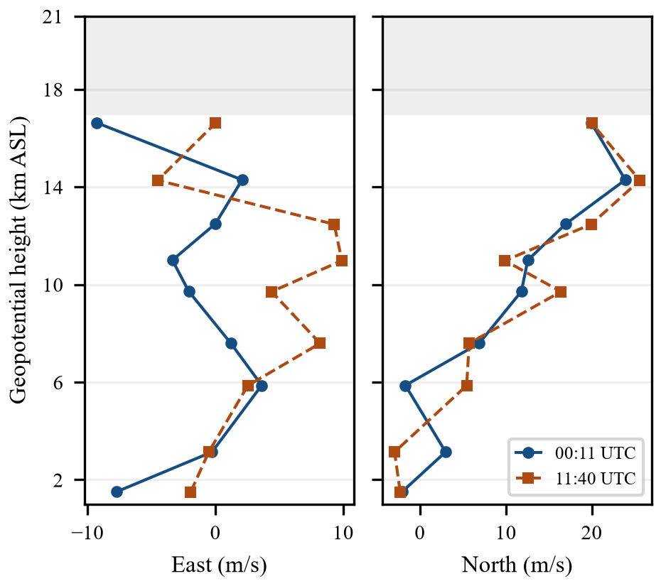
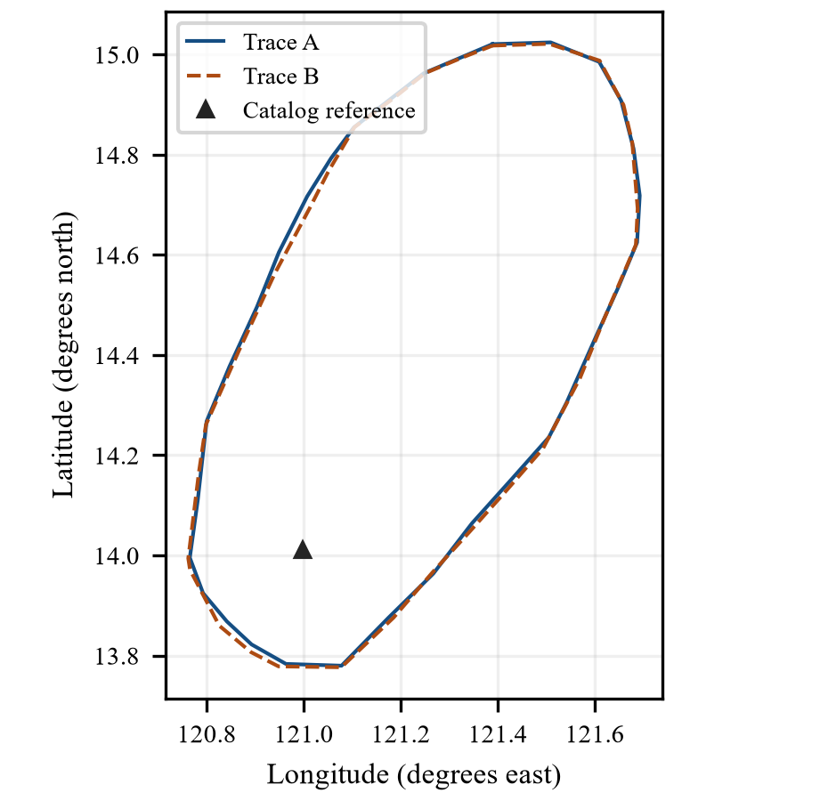

# Volcanic Processes and Hazard Evidence from Taal Mayon and Kanlaon

| Author | Department | University | Location | Email |
| --- | --- | --- | --- | --- |
| Bas, Wayne Harty C. | Computer Studies Department | University of Caloocan City | Caloocan, Philippines | bas.waynehartybscs2023@gmail.com |
| Baynosa, Michael Angelo B. | Computer Studies Department | University of Caloocan City | Caloocan, Philippines | baynosa.michaelangelobscs2023@gmail.com |
| Bobis, Daniel D. | Computer Studies Department | University of Caloocan City | Caloocan, Philippines | bobis.daniel.bscs2023@gmail.com |
| Cueto, Stephanie D.C. | Computer Studies Department | University of Caloocan City | Caloocan, Philippines | cueto.stephaniebscs2023@gmail.com |
| Santiago, Carmelo A. | Computer Studies Department | University of Caloocan City | Caloocan, Philippines | santiago.carmelobscs2023@gmail.com |
| Sison, Kane Andrew C. | Computer Studies Department | University of Caloocan City | Caloocan, Philippines | sison.kaneandrewbscs2023@gmail.com |
| Villarba, Cj I. | Computer Studies Department | University of Caloocan City | Caloocan, Philippines | villarba.cjbscs2023@gmail.com |

BSCS 4B | CSE 103 - Computational Science

17 October 2026

## Abstract

Volcanic hazards in the Philippines reflect interactions among eruption processes, atmospheric transport, ground deformation and the distribution of exposed communities. This study examined the volcanic evidence associated with Taal, Mayon and Kanlaon through a descriptive analysis of published research and archived geographic and monitoring records. Taal's January 2020 eruption provided the principal event evidence; Mayon and Kanlaon supplied contrasting volcanic settings. Sources included volcano profiles, a published tephra study, a geodetic investigation, Tanay radiosonde observations, a regional earthquake catalog and municipal population records. Observations, published interpretations and locally derived summaries were evaluated separately. The retained evidence describes a lake-caldera setting at Taal and stratovolcano settings at Mayon and Kanlaon. Two Tanay launches each covered 15 of 21 specified atmospheric heights, limiting characterization of winds near the upper eruption column. Of 49 archived regional earthquakes, 48 were deeper than 15 km and could not be treated as a record of shallow volcanic unrest. Geographic records covered 318 municipalities and cities, with incomplete historical and spatial coverage. The findings show why ashfall, subsurface processes and community exposure require complementary evidence. They support a source-based interpretation of volcanic hazards while identifying the observations needed for stronger event-specific conclusions.

Keywords: volcanic hazards; Taal; Mayon; Kanlaon; tephra; atmospheric winds; seismicity; ground deformation

## I. Introduction

Volcanic hazards arise through several physical processes that differ in their geographic reach and effects. Explosive activity produces tephra that can be transported beyond a volcano's slopes, while lava and pyroclastic density currents interact strongly with the land surface. Subsurface magma movement can also deform the ground. Understanding these processes requires attention to the observation being measured, its location and its time of occurrence. A deposit thickness, an earthquake depth and a displacement estimate describe different parts of a volcanic system.

Taal, Mayon and Kanlaon provide distinct Philippine settings for examining these relationships. The retained Smithsonian Global Volcanism Program (GVP) profiles identify Taal as a caldera and Mayon and Kanlaon as stratovolcanoes (GVP, n.d.-a, n.d.-b, n.d.-c). Their geographic records establish the study locations, while the available event literature is concentrated on Taal. Taal's January 2020 eruption is documented through tephra observations and satellite geodesy, providing complementary evidence about processes above and below the surface (Balangue-Tarriela et al., 2022; Bato et al., 2021).

The interpretation of volcanic effects also depends on what is exposed. Administrative population totals identify the scale of surrounding communities, but do not locate every resident or describe the condition of individual buildings and crops. Ash impacts depend on deposit properties, roof characteristics, rainfall and the susceptibility of affected assets (U.S. Geological Survey [USGS], 2015, n.d.-a). Geographic proximity alone is therefore insufficient to establish damage.

This study aimed to synthesize the volcanic processes and scientific evidence represented in the retained data collection. It addressed three questions: what the documented observations indicate about volcanic activity; how atmospheric, temporal and geographic coverage constrain their interpretation; and what the available records can support about community exposure. The study concentrates on published and archived evidence. It does not present new field measurements, laboratory analyses, a complete eruption chronology for all three volcanoes or a comparative ranking of their danger.

## II. Methods

### 2.1 Research design and scope

A descriptive secondary-data design combined documentary review with numerical summaries of archived records. The review covered geographic profiles for Taal, Mayon and Kanlaon, published evidence concerning Taal's January 2020 eruption, two upper-air observations from the eruption date, selected regional earthquakes dated 2021-2024 and municipal demographic records. Taal served as the principal event case because its retained sources provided both deposit and deformation evidence. The other two volcanoes supplied geographic and process context rather than equivalent event datasets.

The data collection was reviewed as retained on 17 October 2026. Publication dates, observation dates and census years were recorded separately. Findings from different years were not combined into a single eruptive episode. In particular, the 2021-2024 earthquake records were examined as regional context and were not used to explain the onset of the January 2020 eruption.

### 2.2 Sources and evidence selection

The principal published event sources were the tephra study by Balangue-Tarriela et al. (2022) and the satellite radar investigation by Bato et al. (2021). Geographic context came from GVP profiles. Atmospheric evidence came from NOAA's Integrated Global Radiosonde Archive, version 2.2, for Tanay station RPM00098433. Regional earthquakes were retained from the archived USGS catalog. Administrative boundaries and population information were associated with geoBoundaries (n.d.) and Philippine Statistics Authority (PSA, n.d.-a, n.d.-b) sources.

Each numerical claim was classified as a reported observation, a published interpretation or a locally derived result. A source title or institutional attribution alone was insufficient to qualify a value as an observation. Records without an identifiable measurement, page or product locator were excluded from numerical conclusions. Such records remained relevant as evidence gaps. Assumed parameter values and unsupported municipal thickness assignments were not included as measured deposits.

Published findings were attributed to their original investigators. This study did not repeat their field sampling or geodetic inversion. Locally derived results were limited to summaries of the retained records and comparison of existing digitized contours. This distinction prevents repeated use of one source from appearing to provide several independent observations.

### 2.3 Atmospheric and spatial data treatment

The atmospheric analysis used the Tanay launches released at 00:11 and 11:40 UTC on 12 January 2020. Usable levels required height and wind information; missing or removed values were rejected. Meteorological wind directions describe the direction from which the wind arrives, measured clockwise from north. Eastward and northward components were used to inspect changes with altitude without averaging directional angles directly (NOAA National Centers for Environmental Information [NCEI], n.d.).

Altitude coverage was evaluated on a specified 1 km grid from 1 to 21 km above sea level. Interpolation was restricted to the observed vertical range. The pre-existing review criterion required at least 75% of these heights to be covered before a vertically representative summary could be accepted. This was a study screening rule, rather than a universal atmospheric standard. No observations were extrapolated into the unmeasured upper layer. Heights above sea level and heights above a vent were treated as different reference quantities.

Geographic records used longitude and latitude with an explicitly stated WGS84 reference. Municipal identifiers were checked against the retained PSGC correspondence records. The existing inventory used 200 by 200 km squares centered on the three catalog locations to identify intersecting administrative polygons. These squares defined the geographic inventory extent; their edges were not interpreted as physical hazard boundaries.

Two pre-existing digitizations of the same published outer tephra contour were compared using their archived area and geometry summaries. Their agreement described repeatability in reading the source map. Because both traces originated from one published figure, they did not constitute independent field surveys. Coordinates inferred from printed graticules retained uncertainties associated with map reading and the source datum.

### 2.4 Seismic geodetic and exposure interpretation

The 49 retained USGS earthquake records were summarized by observation period and reported depth. A 15 km depth division was used descriptively to distinguish the shallowest retained event from deeper regional events. That division was not used to determine earthquake origin. No event was classified as volcanic solely because it occurred near Taal. The catalog's temporal coverage and selection limited its suitability for interpreting local unrest (USGS, n.d.-b).

Geodetic findings were extracted from the published Taal investigation and checked against the retained source locator. Dike dimensions and general propagation direction were treated as results of the original inversion, not direct surface measurements. A schematic azimuth was excluded from quantitative directional conclusions. This study did not recalculate deformation fields or infer an eruption date from them.

Population values retained their census year and administrative unit. Records for 2020 and 2024 were kept separate, and a missing historical value was not replaced by a later count. Municipal centroids were treated as geographic reference points. Neither a centroid nor a whole-municipality total was taken to locate people within an observed ashfall contour. Building and agricultural consequences were discussed qualitatively using source-specific susceptibility factors rather than a universal thickness threshold.

## III. Results

### 3.1 Volcanic settings and process evidence

The geographic collection distinguished the lake-caldera setting at Taal from the stratovolcano settings at Mayon and Kanlaon (Table 1). These classifications identify differences in volcanic form and environmental context. They do not establish that the volcanoes share eruption magnitude, ash characteristics or patterns of community exposure.

Table 1. Retained geographic reference locations and volcanic settings. Coordinates identify catalog locations and are not surveyed vent positions for a particular eruption. Source: GVP profiles and their locally retained transcriptions.

| Volcano | Geographic reference | Setting |
| --- | --- | --- |
| Taal | 14.0106° N, 120.9975° E | Lake caldera |
| Mayon | 13.2570° N, 123.6850° E | Stratovolcano |
| Kanlaon | 10.4096° N, 123.1300° E | Stratovolcano |

The Taal case connected an explosive eruption with a lake environment and subsurface deformation. Mayon's published volcanic history provides examples of lava movement, ash emissions and pyroclastic density currents, illustrating how several processes can occur at one stratovolcano (GVP, n.d.-b). The retained Kanlaon profile supported a geographic comparison, but the reviewed collection did not provide an equivalent set of event-specific deposit measurements. The available evidence therefore supported a detailed Taal case study within a broader Philippine volcanic setting.

### 3.2 Taal ashfall and atmospheric conditions

Balangue-Tarriela et al. (2022) describe phreatomagmatic activity during the 12 January 2020 eruption, an eruption column reaching approximately 17-21 km above sea level and tephra transport toward the north-northeast. Their reported regional fallout area was 8,605 km². The same paper's Table 3 lists 3,864.89 km² for the outer 0.05 cm isopach, equivalent to 0.5 mm. These two area statements were retained separately because their relationship could not be resolved from the available definitions.

The archived Tanay launches each retained nine usable wind levels. Heights spanned 1,510-16,630 m in the first profile and 1,504-16,610 m in the second. Interpolation covered the 2-16 km grid heights: 15 of the 21 specified levels, or 71.43%. Both profiles fell below the study's 75% coverage criterion. Their approximately 74.8 km separation from the Taal reference location also limited their representation of conditions directly over the eruption.

Figure 1. Eastward and northward wind components from Tanay on 12 January 2020. Circles identify 00:11 UTC and squares identify 11:40 UTC. Lines connect retained measurements. Shading marks the 17-21 km layer without observations; it does not supply extrapolated wind values. Source: archived NOAA IGRA observations.

The profiles showed changes in both wind components with altitude and between launches (Figure 1). The unmeasured upper layer overlapped the reported upper eruption-column range. These observations supported examination of vertical wind structure, but did not establish a complete wind field for the eruption. The absence of an accepted vertically representative wind summary was a limitation of the retained observations.

The two digitizations of the published outer contour yielded geodesic areas of 8,639.95 and 8,656.14 km², differing by approximately 0.187%. Their archived intersection-over-union was 0.97918. This close agreement concerned the reading of the same map (Figure 2). It did not resolve the publication's differing area statements or supply additional field measurements. Differences in datum, map reading, deposit preservation and the mapped event interval remained relevant to interpretation.

Figure 2. Two independently digitized traces of the outer 0.5 mm tephra contour in the published Taal study. The triangle marks the GVP catalog reference location. Both traces derive from the same source figure. Adapted from Balangue-Tarriela et al. (2022), Figure 4a, CC BY 4.0; digitized geometry was used to redraw the contours.

### 3.3 Regional seismicity and ground deformation

The archived regional earthquake selection contained 49 events dated between 15 January 2021 and 18 December 2024, with reported depths ranging from 10.00 to 233.96 km. Only one event had a depth of 15 km or less; the other 48 were deeper. These counts described the retained catalog selection rather than all earthquakes in the region. They could not be interpreted as a time series of shallow volcanic earthquakes or as precursors to the 2020 eruption.

The deformation evidence concerned a separate observation period. Bato et al. (2021) used satellite radar data to investigate changes before, during and after the 2020 eruption. Their co-eruptive interpretation included a near-vertical dike approximately 21 by 8 km, extending southwest from Volcano Island. The retained source locator supported these dimensions. The locally stored 225° direction was only a schematic representation of southwest and was not retained as a separately measured inversion result.

Taken together, these sources documented different aspects of the region: later earthquake hypocenters and published interpretations of deformation during the 2020 crisis. Their differences in timing and observation type prevented direct correlation. The earthquake selection could not independently confirm or contradict the published dike interpretation.

### 3.4 Geographic coverage and community context

The demographic collection contained 318 municipality and city records with 2024 population counts. Historical 2020 counts were retained for 34 Batangas jurisdictions; 284 municipal records lacked that historical population value. The two airport reference points were separate from the municipal population inventory. These counts described data availability and did not measure the population affected by any eruption (PSA, n.d.-a, n.d.-b).

Table 2. Administrative coverage within the retained geographic inventory extents. Included records have a resolved local administrative match. Unresolved records remain outside the accepted inventory; the totals refer to separate extents and are not additive counts of unique jurisdictions.

| Volcano | Included / total | Unresolved |
| --- | --- | --- |
| Taal | 162 / 214 | 52 |
| Mayon | 37 / 112 | 75 |
| Kanlaon | 109 / 171 | 62 |

Coverage varied among the three geographic extents (Table 2). Administrative polygons could intersect an extent while their centroids lay beyond it; this occurred in 23 included extent records. A centroid therefore did not represent an entire municipality's location relative to an observed deposit. The incomplete inventory and missing historical populations prevented a complete estimate of exposure during the January 2020 event.

### 3.5 Limits of the retained monitoring records

The retained post-2020 activity log contained 11 entries whose individual bulletin values had not been verified against archived measurement locators. Their sulfur dioxide, plume-height and alert-level numbers were excluded from numerical trends in this study. A separate TROPOMI reference lacked the product granule, orbit details, quality selection and reproducible derivation needed to support quantitative plume measurements.

Institutional monitoring metadata and damage-proxy dataset links also lacked sufficient verification for quantitative conclusions. Municipal caldera-deposit entries did not provide record-specific sampling or publication locators, and a contextual five-level wind profile lacked a level-by-level derivation from the archived launches. These entries could identify subjects for further source review, but could not supplement measured thicknesses, winds, gas fluxes or damage totals. Their exclusion did not imply that the physical phenomena were absent.

## IV. Discussion

### 4.1 Interpreting complementary volcanic observations

The first research question concerned what the evidence indicates about volcanic processes. The most substantial event evidence came from Taal, where deposit observations, atmospheric measurements and published geodesy described different parts of the same broader volcanic setting. Tephra records concerned material deposited at the surface, wind observations described atmospheric transport conditions, and the geodetic interpretation concerned magma movement beneath the caldera. One type of observation could not substitute for another.

Taal's lake environment and the documented phreatomagmatic character of the 2020 eruption distinguish its event context from a description based only on volcanic form. Mayon's history similarly shows why a stratovolcano should not be reduced to one process: effusive and explosive activity can generate different types of deposits and flow hazards (GVP, n.d.-b). The more limited retained Kanlaon evidence prevented an equivalent comparison of event mechanisms or affected areas.

The regional earthquakes require particular care. Depth and proximity are useful descriptors, but neither identifies a volcanic cause on its own. The dominance of deeper events in this selected archive demonstrated the need for locally appropriate seismic observations before discussing shallow unrest. Likewise, the published Taal dike dimensions should be interpreted within the original geodetic methods and observation period rather than transferred to later earthquakes without evidence.

### 4.2 Atmospheric coverage and geographic interpretation

The second research question concerned the support provided by the observations. The Tanay records showed that a sounding can contain useful measurements while still leaving an important vertical interval unobserved. Winds below approximately 16.6 km could not determine winds throughout an eruption column reported to reach 17-21 km above sea level. A complete interpretation of ash transport would require adequate observations across the relevant heights, locations and stages of the event.

Close agreement between two digitized contours improved confidence in reading the source map, but did not establish independent observational agreement. Both outlines inherited uncertainties from the published map and its underlying data. The unresolved difference between the reported area statements also cautioned against selecting a single area without explaining which deposit definition it represents. Surface ashfall extent, a specified thickness contour and a geographic inventory boundary answer different questions.

### 4.3 Community exposure and study limitations

The third research question concerned community exposure. Municipal populations and boundaries provide a useful administrative frame for identifying communities that warrant further investigation. They do not specify the distribution of residents inside a deposit, the vulnerability of individual structures or the severity of agricultural effects. USGS guidance identifies building characteristics and ash conditions as important to structural impacts, while agricultural consequences also vary with crop type and growth stage (USGS, 2015, n.d.-a).

Historical exposure requires population information that matches the event period as closely as the available census evidence allows. Replacing a missing 2020 value with a 2024 count would introduce demographic change into an apparent historical estimate. Polygon and centroid differences also prevent interpretation of a municipality as uniformly affected. Detailed exposure assessment would require spatial population data, observed deposit information and local asset characteristics.

This study was limited by uneven evidence among the three volcanoes, selection limits in the earthquake archive, incomplete atmospheric coverage and insufficiently documented contextual records. It did not estimate eruption probabilities, reproduce the original geodetic inversion, derive airborne concentrations or assess specific buildings, crops or water facilities. The findings concern a documented historical case and the support available in the retained sources. Current decisions require dated observations and guidance from the responsible scientific authorities.

### 4.4 Conclusion

The reviewed evidence supports a volcanic study centered on Taal's documented eruption processes and their atmospheric, subsurface and geographic context, with Mayon and Kanlaon providing additional volcanic settings. The analysis showed that the available observations differed substantially in temporal and spatial support. Incomplete upper-air coverage, predominantly deeper regional earthquake records and gaps in historical population information limited the conclusions that could be drawn about a specific eruption and its exposed communities.

Stronger volcanic interpretation requires complementary observations with identifiable sources, appropriate dates and clearly stated uncertainty. Further work should prioritize event-specific atmospheric profiles, traceable deposit measurements, local volcanic seismicity, dated gas observations and spatial exposure data. Maintaining these distinctions permits the available scientific evidence to inform volcanic understanding without overstating what has been measured.

## References

Balangue-Tarriela, M. I. R., Lagmay, A. M. F., Sarmiento, D. M., Vasquez, J., Baldago, M. C., Ybañez, R., Ybañez, A. A., Trinidad, J. R., Thivet, S., Gurioli, L., Van Wyk de Vries, B., Aurelio, M., Rafael, D. J., Bermas, A., & Escudero, J. A. (2022). Analysis of the 2020 Taal Volcano tephra fall deposits from crowdsourced information and field data. Bulletin of Volcanology, 84, Article 35. https://doi.org/10.1007/s00445-022-01534-y

Bato, M. G., Lundgren, P., Pinel, V., Solidum, R., Daag, A., & Cahulogan, M. (2021). The 2020 eruption and large lateral dike emplacement at Taal volcano, Philippines: Insights from satellite radar data. Geophysical Research Letters, 48, e2021GL092803. https://doi.org/10.1029/2021GL092803

geoBoundaries. (n.d.). Philippines ADM3 simplified boundaries and metadata [Data set; boundary year 2020]. William & Mary geoLab. https://www.geoboundaries.org/countryDownloads.html

National Oceanic and Atmospheric Administration, National Centers for Environmental Information. (n.d.). Integrated Global Radiosonde Archive, version 2.2 [Data set and format documentation; Tanay station RPM00098433]. https://www.ncei.noaa.gov/products/weather-balloon/integrated-global-radiosonde-archive

Philippine Statistics Authority. (n.d.-a). Philippine Standard Geographic Code provincial city and municipality directories [2024 population data]. https://psa.gov.ph/classification/psgc

Philippine Statistics Authority. (n.d.-b). Batangas QuickSTAT [2020 and 2024 population counts, page 2; identifier 26R0410-QS-005]. Batangas Provincial Statistical Office. https://rsso04a.psa.gov.ph/sites/default/files/infographics/26R0410-QS-005.pdf

Smithsonian Institution, Global Volcanism Program. (n.d.-a). Kanlaon [Volcano profile; number 272020]. https://volcano.si.edu/volcano.cfm?vn=272020

Smithsonian Institution, Global Volcanism Program. (n.d.-b). Mayon [Volcano profile; number 273030]. https://volcano.si.edu/volcano.cfm?vn=273030

Smithsonian Institution, Global Volcanism Program. (n.d.-c). Taal [Volcano profile; number 273070]. https://volcano.si.edu/volcano.cfm?vn=273070

U.S. Geological Survey. (2015, December 17). Volcanic ash impacts and mitigation: Buildings. https://volcanoes.usgs.gov/volcanic_ash/buildings.html

U.S. Geological Survey. (n.d.-a). Volcanic ash impacts and mitigation: Agriculture, plants and animals. https://volcanoes.usgs.gov/volcanic_ash/agriculture.html

U.S. Geological Survey. (n.d.-b). ANSS Comprehensive Earthquake Catalog [Data set and documentation; selected archived regional records dated 2021-2024]. https://earthquake.usgs.gov/data/comcat/
