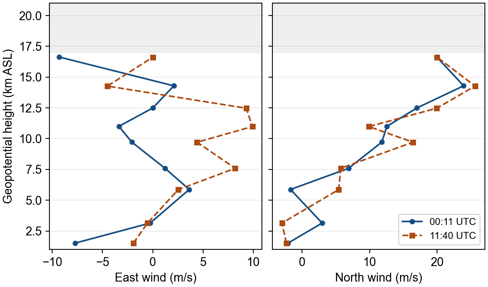
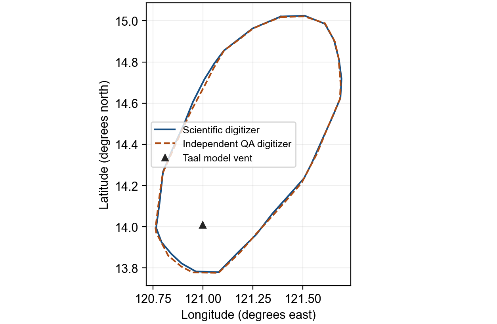
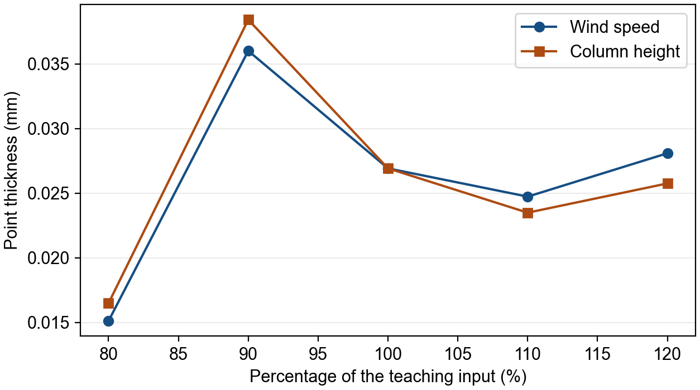

# ABO: A Gaussian Ashfall Model and Interactive Eruption Laboratory for Philippine Volcanoes

BSCS 4B | CSE 103 - Computational Science

12 October 2026

## Abstract

ABO is a local computational science application for examining how eruption inputs, wind and prescribed settling speeds influence ground ash deposition around Taal, Mayon and Kanlaon. This study developed and evaluated a reduced analytical Gaussian fallout model implemented in Python and presented through a React interface. The model integrates deposits exactly over rectangular cells, samples municipal centroids, evaluates 360 wind directions and computes accumulation during and after a finite period of constant ash emission. Geographic three-dimensional illustrations and an optional terrain-guided lava teaching model provide additional context. Evaluation combined independent synthetic references, conservation and coordinate checks, data-provenance audits and browser workflows. Verification passed 164 Python cases, alongside frontend regression and build checks. A saved illustrative Mayon request emitted 36,000,000 kg of ash; 30,459,336.29 kg deposited within the model domain and 5,540,663.71 kg outside it after complete settling. These values are computational results of assumed inputs, not observations of a Mayon eruption. A frozen Taal retrospective protocol rejected both candidate soundings for insufficient altitude coverage. Two independent traces of a published contour agreed closely, but shared source dependence and missing physical inputs prevented predictive evaluation. ABO supports reproducible educational exploration and point-exposure screening; historical accuracy and damage assessments remain unestablished.

Keywords: volcanic ashfall; Gaussian fallout; finite emission; municipal screening; scientific visualization

## 1. Introduction

Volcanic ash deposition affects communities through ground loading and disruption of infrastructure and agriculture. Philippine eruptions motivate locally interpretable tools: Balangue-Tarriela et al. (2022) documented the January 2020 Taal fallout using crowdsourced information and field observations. Building impacts depend on deposit characteristics, structural design and environmental conditions rather than one universal thickness limit (U.S. Geological Survey [USGS], 2015). A computational tool should therefore distinguish calculated deposition from evidence of damage.

Analytical tephra models provide a practical basis for exploring transport and settling. Tephra2 estimates accumulated tephra mass using eruption and particle inputs and allows wind to vary with height (Geoscience Community Codes, n.d.). ABO adopts the general analytical advection-diffusion approach but uses a simpler release distribution, one effective horizontal wind and prescribed settling speeds. Its equations and implementation are defined independently; equivalence to the complete Tephra2 model is not claimed.

The study aimed to develop a reproducible Python and React application that links explicit physical assumptions to maps, centroid samples and three-dimensional teaching illustrations. It addressed three questions: whether the reduced model preserves its analytical and mass-accounting properties; whether the interface presents consistent quantities and unavailable evidence; and what additional information is required before the application can support historical evaluation. The initial proposal's broader aspirations for seasonal presets, Taal replication and impact thresholds are treated as requirements whose scientific completion must be demonstrated.

The study covers a regional flat-ground ash model, a finite-emission extension, municipal point screening, wind-direction comparison and a separate Mayon lava teaching model. It excludes a solved buoyant eruption column, airborne gas or ash concentration, rainfall removal, aggregation, pyroclastic density currents, lahars and building-specific assessment. Its geographic illustrations improve orientation without supplying these omitted processes.

## 2. Methods

### 2.1 Study design, application and source records

The study used computational model development and verification. No participant study or field sampling was conducted. Python, FastAPI, NumPy, SciPy, pyproj and Shapely supply validation, numerical arrays and spatial operations. React, Three.js and React Three Fiber present backend results; Leaflet displays geographic layers. Python remains the authority for computed quantities and response contracts. The application runs locally on Windows, and simulations use manually curated local scientific records rather than live weather or eruption APIs.

The catalog contains three volcano profiles, 318 municipal/city records with 2024 populations and two airport reference points. Municipal records use unique Philippine Standard Geographic Code identifiers and equal-area centroids derived from simplified geoBoundaries administrative polygons. Population values are transcribed from Philippine Statistics Authority (PSA, n.d.) directories, with source snapshots and census years retained. Official 2020 counts are also recorded for 34 Batangas jurisdictions, with documented administrative-code crosswalks; the other 284 historical counts remain unavailable. Volcano coordinates and reference elevations follow Smithsonian Global Volcanism Program (n.d.) profiles.

The coverage audit identifies administrative polygons intersecting each fixed simulation square, including unresolved name/code matches. Taal includes 162 of 214 intersecting records, Mayon 37 of 112, and Kanlaon 109 of 171; the remainder are explicitly unresolved. These domain totals overlap and must not be summed as unique jurisdictions. Twenty-three included domain records have their centroids outside the relevant square, so their point predictions remain unknown even though part of the polygon intersects it. A centroid represents one sample, not every location in a municipality. The inventory remains partial rather than complete national or domain coverage.

Static geographic assets combine Mapzen Skadi elevation, Natural Earth land and lakes, and a cached OpenStreetMap Taal Lake polygon with its island holes (Mapzen, n.d.; Natural Earth, n.d.; OpenStreetMap contributors, n.d.). Each volcano backdrop spans 100 by 100 km with 250 m display samples. Horizontal coordinates are WGS84 and elevations use the EGM96 geoid. Raw Mayon elevation also supports the separate lava route. Historic terrain and generalized shorelines are not current crater surveys. Source identifiers, units, conversions, dates, hashes and interpretation limits are retained in the project registry.

### 2.2 Coordinates, inputs and assumptions

A vent-centered azimuthal-equidistant projection expresses east and north distances in metres. Geographic transformations explicitly use longitude before latitude. The ash grid spans 200 by 200 km with 1 km cells: 200 rows and 200 columns. Model ground is flat at the submitted vent datum. A plume height reported above sea level must be reduced by that datum before being used as height above model ground. The published Taal height range of 17-21 km above sea level consequently cannot be entered as an unconverted above-ground value (Balangue-Tarriela et al., 2022).

Ash emission is constant for the specified duration. Horizontal wind is uniform, diffusion is isotropic, class settling speeds are constant and the default release distribution has 16 equally weighted midpoint heights. Grain fractions sum to one. Bulk deposit density converts accumulated load to thickness; it is distinct from particle density. Representative diameters label the classes but do not determine their terminal speeds in this implementation.

Table 1. Illustrative ash inputs used in the saved Mayon example. All physical entries below are teaching assumptions, not event measurements.

| Input | Value | Unit |
| --- | --- | --- |
| Column height above model ground | 5,000 | m |
| Modeled ash emission rate | 10,000 | kg/s |
| Constant-emission duration | 3,600 | s |
| Effective wind speed | 10 | m/s |
| Meteorological wind-from bearing | 225 | degrees clockwise from north |
| Horizontal diffusivity | 500 | m²/s |
| Initial Gaussian standard deviation | 250 | m |
| Bulk deposit density | 1,000 | kg/m³ |

Table 2. Assumed grain classes in the teaching example.

| Diameter (µm) | Mass fraction | Settling speed (m/s) |
| --- | --- | --- |
| 32 | 0.10 | 0.05 |
| 63 | 0.15 | 0.20 |
| 125 | 0.25 | 0.80 |
| 250 | 0.30 | 3.00 |
| 500 | 0.20 | 10.00 |

### 2.3 Eventual Gaussian ground deposition

Let Q denote modeled ash rate in kg/s, T duration in seconds, H column height in metres, J release layers, w_i the mass fraction of class i and v_i its settling speed in m/s. Total mass M and release height h_j are:

M = Q T;  h_j = H(j + 0.5)/J,  j = 0, ..., J - 1.  (1)

For wind-from bearing f, converted to radians, the east and north transport components are:

u_E = -U sin(f);  u_N = -U cos(f).  (2)

Wind from north therefore transports south; wind from east transports west. Calm wind remains valid. Each class-height component has falling time τ_ij, Gaussian center μ_ij and horizontal variance s_ij²:

τ_ij = h_j/v_i;  μ_ij = (u_E τ_ij, u_N τ_ij);  s_ij² = σ_0² + 2Kτ_ij.  (3)

Here K is diffusivity in m²/s and σ_0 is initial standard deviation in metres. Point ground load L at local coordinates (E, N) is:

L(E,N) = Σ_ij [M w_i/(J 2π s_ij²)] exp(-[(E-μ_E,ij)² + (N-μ_N,ij)²]/[2s_ij²]).  (4)

Each normalized component integrates to its allocated mass over an infinite plane. The model sums components through NumPy broadcasting and reductions, without Python iteration over scientific grid cells. Ordinary input parsing and serialization are separate from this numerical requirement.

For a cell with east limits a and b and north limits c and d, the component probability is the product of normal cumulative-distribution differences along both axes. Using Φ for the standard normal cumulative distribution function:

P_ij = [Φ((b-μ_E,ij)/s_ij) - Φ((a-μ_E,ij)/s_ij)] [Φ((d-μ_N,ij)/s_ij) - Φ((c-μ_N,ij)/s_ij)].  (5)

Cell mass is Σ_ij (M w_i/J) P_ij; dividing by cell area yields cell-average load in kg/m². Thus, a grid cell is integrated exactly within the specified mixture rather than approximated by its center. Receptor loads use Equation 4 directly. Deposit thickness is d_mm = 1000 L/ρ_bulk, where ρ_bulk is in kg/m³. Mass inside the finite square and mass outside it are reported separately; the grid is not renormalized to conceal loss beyond its extent.

### 2.4 Finite emission and eruption illustrations

At observation time t, material released at time b arrives after b + τ_ij. Integrating constant emission over 0 ≤ b ≤ T gives the arrived component mass:

A_ij(t) = (M w_i/J) clip((t - τ_ij)/T, 0, 1).  (6)

Substituting A_ij(t) for final component mass in Equations 4 and 5 computes accumulated deposition. Emitted mass is Q min(t,T); still-aloft mass is emitted mass minus arrived mass. Arrived mass splits into inside-domain and outside-domain deposits. Complete accumulation occurs at T + max(τ_ij), over every class and layer, rather than when emission stops.

The default response contains 37 snapshots, with nonuniform spacing during emission and its fallout tail. Requests whose extreme values cannot maintain the requested distinct clock samples are rejected. Python supplies representative airborne centers and spreads from the surviving age intervals; React interpolates supplied geometry and renders enlarged billows. The map and location inspector retain the preceding computed snapshot during interpolation; the folded table and CSV contain eventual quantities. The visible hour-based clock identifies the map snapshot, and a separate label identifies emission duration. A 36-second replay compresses the nonuniform intervals and does not imply a constant physical speed. Source rise, condensed-steam appearance and prescribed Taal fountain arcs are illustrations rather than solved buoyancy, condensation or ballistic hazards. Taal close-up relief is enlarged sixfold and fountain geometry fourfold, with visible labels; regional terrain scale returns to one-to-one.

### 2.5 Terrain-guided lava teaching model

An optional Mayon demonstration routes one channel down the steepest positive drop among eight DEM neighbors. The route uses raw elevations and actual diagonal distances. Its fluid is isothermal, laminar and Newtonian. The mean-speed relation follows the Jeffreys expression discussed by Borch et al. (2025):

v = ρ_l g h² sin(α)/(3η);  h = [3ηq/(ρ_l g w sin(α))]^(1/3);  v = q/(wh).  (7)

Here q is effusion in m³/s, w channel width in metres, h depth normal to the inclined channel in metres, ρ_l lava density in kg/m³, η dynamic viscosity in Pa·s and α slope angle. The computation adopts gravitational acceleration g = 9.80665 m/s². The teaching inputs are q = 5 m³/s, w = 20 m, η = 1,000 Pa·s and ρ_l = 2,600 kg/m³. These values are assumed and are independent of ash inputs. Travel time uses inclined segment length divided by mean velocity, and volume uses width times normal depth times inclined length.

Routing stops at water, a flat or pit, the asset edge, the declared horizontal distance cap or the effusion-duration limit. Current-time footprints use the prescribed width; the visible ribbon is enlarged separately. The implementation does not represent cooling, crystallization, yield strength, branching, constriction backup, pond filling or surface changes. General lava-flow controls described by USGS (n.d.) and the dated Mayon bulletin (Philippine Institute of Volcanology and Seismology [PHIVOLCS], 2023) provide context, not calibration of this route or its material values.

### 2.6 Screening, wind sweep and evaluation

The default 0.5 mm contour defines a reporting footprint, not a damage threshold. Receptor comparisons use greater-than-or-equal thresholds. Conditional screening requires a reviewed criterion, an explicitly supported receptor type and matching conditions selected for the scenario or recorded for that receptor. An absent type, condition or applicability basis returns unknown with a reason. A municipal roof or crop context is a conditional scenario, not a survey of local buildings or crops. Missing damage criteria or outside-domain receptors retain unknown status. Indicative population totals deduplicate municipality identifiers; whole municipal populations selected by a centroid are not people counted inside a deposit polygon. Airport and water-facility results describe surface deposition only, not airborne aviation safety or water potability. Population years are selected explicitly; a missing 2020 value cannot be replaced with a 2024 count.

The sweep evaluates bearings from 0 through 359 degrees at one-degree intervals directly at receptors, holding all other inputs fixed. Each receptor receives its maximum load and corresponding wind-from bearing, with exact ties resolved to the lowest angle. These individual maxima form an envelope across different scenarios, not one simultaneous regional deposit.

Verification used independent scalar expectations, zero-mass and calm-wind cases, cardinal bearings, projection round trips, finite nonnegative outputs, threshold equality, cell-resolution comparisons, release-layer sensitivity, timeline monotonicity, final-state agreement, lava travel and volume, invalid local terrain and preallocation resource bounds. Browser checks traced completed results through stages, selectors, point inspection, map labels, exports and responsive themes. Memory is conservatively bounded at 512 MiB and concurrent calculations are limited.

Historical evaluation requires dated event inputs and independent geolocated observations with uncertainty. Calibration and evaluation samples must be separate. The implemented comparison reports signed interval residuals, midpoint residuals, interval-distance RMSE and MAE, midpoint RMSE and MAE, coverage and grid-center footprint intersection-over-union within the modeled domain. The compatibility field rmse_mm denotes interval-distance RMSE. For a reported interval [a,b], an interval residual is p-a below a, p-b above b, and zero inside the interval; midpoint error instead compares p with (a+b)/2. Per-observation records retain coordinates, split, dependency group and outside-domain reasons. A scalar isopach area cannot establish spatial overlap. Numerical verification, input readiness and historical assessment remain separate statuses.

### 2.7 Frozen retrospective protocol and public wind evidence

The first retrospective target is the mapped Taal main-plume fallout from 12 January 2020 at 13:00 to 13 January at 04:28 Philippine Standard Time, equivalent to 05:00-20:28 UTC on 12 January, or 55,680 s. Protocol taal-main-plume-2020-v1 and dataset taal-published-evidence-v1 were frozen before model agreement was calculated. The study also uses an approximately 04:00 endpoint for a figure and a narrower intense-plume period. Its transition to lava fountaining at 02:49 is another event definition. These intervals are preserved separately; the mapped interval is not treated as a measured period of constant emission. The Smithsonian profile elevation of 311 m is not established as the historical active-vent datum.

The parameter register classifies measured, derived, calibrated and assumed values and retains units, datum, uncertainty, source locator, license, conversions and dependencies. Deposit-derived volume, inferred plume height, thickness observations and contours from the same study share a dependency family. Distal samples do not independently establish the emitted grain spectrum. Ash mass and bulk deposit density cannot be identified separately from thickness alone because their ratio sets the amplitude.

NOAA IGRA 2.2 station RPM00098433 at Tanay was chosen as the public sounding candidate. The selected nominal 00:00 and 12:00 UTC launches on 12 January were archived with their actual release times, raw fields and source hashes. Missing or removed values are rejected; wind speed in tenths of m/s is converted to m/s, height processing flags are retained and no nonexistent independent wind-quality flag is invented. Meteorological wind-from bearings are converted to east and north components before averaging. Each profile is interpolated onto a fixed 1 km geopotential-height grid from 1 to 21 km ASL, only within observed coverage. The frozen rule requires at least 75% of these 21 heights. Accepted heights and launches would receive equal weights; a resultant below 0.1 m/s would have no assigned direction. Station distance, launch offsets, shear and altitude conventions remain representativeness limitations (NOAA National Centers for Environmental Information [NCEI], n.d.).

Independent eruption inputs are preferred, with all deposit measurements held out. If calibration becomes necessary, only diffusivity and initial spread are eligible under this protocol. A deterministic 70% calibration and 30% evaluation split operates on complete spatial groups, rounding down the calibration count and retaining at least one evaluation group. Duplicate coordinates and shared measurements remain together. A dependency family is confined to one partition or excluded from an independent-point claim. Interpolated contour vertices do not become additional independent observations. The split is frozen before fitting and evaluation observations cannot guide parameter tuning.

Contour-derived evidence requires two independent traces, documented georeferencing residuals and measured inter-trace disagreement. Two digitizers independently froze pixel traces of the published Figure 4a outer 0.05 cm contour before comparing coordinates or model outputs. The source PDF, XML, image and metadata were archived through the official NIH PMC open-data archive, retaining hashes and the article's CC BY 4.0 license. Separate affine fits translate printed longitude/latitude ticks into coordinates, assuming WGS84 because the original map datum is unspecified. WGS84 geodesic areas and a vent-centered azimuthal-equidistant overlay quantify repeatability and clipping. Both traces belong to the same dependent source family, with zero independent point observations (Balangue-Tarriela et al., 2022; National Library of Medicine [NLM], n.d.).

The source's fitting assumptions of 10% thickness/diameter and 20% distal-limit error do not establish a complete ABO predictive tolerance. Without accepted spatial uncertainty and independent physical inputs, any comparison is descriptive and validation remains unestablished. Planned sensitivity includes 0.5, 1 and 2 km cells, 8, 16 and 32 release layers and source-supported input endpoints without refitting. No empirical fit was authorized while those evidence gates remained blocked.

## 3. Results

### 3.1 Analytical and software verification

The 12 October verification passed 164 Python cases and 61 frontend cases, alongside lint, formatting, type checking and the production build. The Python total includes 22 fresh independent cases added to the previous 142-case suite. These check scalar cell integrals, wind directions, finite-source mass balance, final-state reproduction and census selection across simulation, sweep and sequence routes. Independent review found that custom receptors could contribute a different census year to selected-year totals; the shared preparation path now selects both catalog and custom records consistently, preserving unknown values and excluding facilities from municipal counts. Source descriptions were also rebuilt with explicit UTF-8 decoding after a Windows encoding defect corrupted units and date ranges. Scientific numeric values were preserved. Earlier reviews corrected wind-bearing normalization, negative populations and nine numerical, timing, terrain, provenance and presentation findings. Test counts demonstrate the tested behavior, not statistical prediction accuracy.

A synthetic calm-wind reference used Q = 100 kg/s, T = 1,000 s, K = 0, σ_0 = 1,000 m and ρ_bulk = 1,000 kg/m³, with three classes sharing equal settling speed. Its total mass was 100,000 kg. Analytical point load at the vent was 0.0159154943 kg/m² and thickness was 0.0159154943 mm. Exact mass in the centered 1 km square was 14,663.1496308 kg, yielding 0.0146631496 kg/m² cell-average load. The difference between point and area-average values was expected and independently tested.

### 3.2 Reproducible teaching example

The saved Mayon sequence request used Tables 1 and 2 and returned 37 snapshots. With the highest release midpoint at 4,843.75 m and slowest settling speed 0.05 m/s, the maximum falling time was 96,875 s. Adding 3,600 s of emission gave a final arrival time of 100,475 s, or about 27.9 h, including 1 h of emission. A fresh local API run produced the final mass accounting in Table 3. This example tests a stated scenario; it does not reconstruct a measured eruption.

Table 3. Final ash mass accounting for the saved illustrative Mayon request.

| Quantity | Mass (kg) | Interpretation |
| --- | --- | --- |
| Emitted ash | 36,000,000.00 | Rate multiplied by duration |
| Deposited inside domain | 30,459,336.29 | Exact integrated mass in the 200 km square |
| Deposited outside domain | 5,540,663.71 | Arrived ash beyond the finite square |
| Still aloft | 0.00 | Complete modeled settling |

Inside-domain and outside-domain mass summed to emitted mass at full settling. The lava route ended at its effusion-volume limit. This stop describes the prescribed channel calculation, not observed runout or a radius of safety.

### 3.3 Data, interface and historical status

Independent cached-source audits reproduced all 318 included 2024 population/code pairs and the 34 Batangas 2020 pairs, and independently recomputed domain intersections and unresolved coverage. Earlier terrain checks covered 17 source hashes, four output hashes, independent elevation samples and source-water samples. These results support local transcription and asset reproducibility within the included inventory, rather than complete domain coverage or reviewed physical presets.

Browser workflows displayed the shared sequence beside the effect map, with explicit snapshot quantities and separately labeled eventual table totals. The 320 px layouts remained within the viewport in both themes. The 11 October production-build timing used the Mayon teaching preset with lava enabled, close-up camera, normal detail, a 1,440 × 1,000 viewport and pixel ratio 1 on a Ryzen 7 5800U / Radeon machine. After one warm-up, three complete replays yielded minimum steady 10-second rates of 51.2, 59.4 and 59.8 rendered frames per second in Chrome, and 58.5, 58.7 and 58.9 in the in-app browser. Raw callbacks and rendered timestamps were retained. Sampled OS foreground ownership and page focus were confirmed. Two Chrome replays overlapped an earlier in-app warm-up; the subsequent in-app campaign was sequential. These measurements replace the earlier one-frame-per-second Chrome observation for that build and setup. They do not certify the 12 October cloud-impostor and terrain-ribbon revision, which received separate functional and visual checks but not a full matched-settings performance campaign. No universal performance guarantee is established.

A 1,823.6-second resource soak completed 20 volcano/run/view cycles and 38 full replays without JavaScript errors. All 38 sampled paused windows rendered zero additional frames. After corrections to shared graphics-resource listeners and retired renderer wrappers, post-collection heap grew from 29.45 MiB after the first cycle to 35.93 MiB after cycle 20, then 59.69 MiB at the end. DOM nodes and event-listener counts rose during repeated view cycles and subsequently stabilized; the full cleanup gate remains open. The soak disabled background throttling for resource continuity and is separate from the foreground performance measurement. Reduced-motion changes and graphics failures received targeted browser tests. A real hidden-page transition, native browser 200% zoom, screen-reader speech and Word's native accessibility checker remain unestablished; CSS zoom and accessibility-tree checks provide narrower evidence.

Historical Taal agreement remained unavailable. The source review preserved the published 8,605 km² narrative footprint and the locally curated Table 3 entry of 3,864.89 km² at 0.05 cm, equivalent to 0.5 mm (Balangue-Tarriela et al., 2022). The differing entries were not silently reconciled or used to invent overlap metrics. No empirical thickness error, validated footprint agreement or forecast accuracy is reported.

### 3.4 Wind-coverage result and descriptive sensitivity

The archived Tanay profiles were released at 00:11 and 11:40 UTC on 12 January 2020. Each retained nine levels with usable height and wind data, spanning approximately 1.5-16.6 km ASL. Interpolation covered the 2-16 km grid heights: 15 of 21, or 71.43%. Both failed the frozen 75% coverage requirement. Their effective historical wind remains unavailable; the coverage threshold was not relaxed after seeing the records. Figure 1 shows the retained components without extrapolation. These data document an unsuccessful source-coverage gate, not a failed model prediction.

Figure 1. Archived Tanay wind components on 12 January 2020. Circles/solid lines identify 00:11 UTC and squares/dashed lines 11:40 UTC. Positive components point east or north. The lines connect retained levels for inspection, rather than supplying winds above the observed range. Source: NOAA IGRA 2.2, RPM00098433; processing and source hashes are retained locally.

An initial publisher-image acquisition returned a browser-challenge HTML response under an image filename. It was rejected before tracing. Subsequent retrieval from the official PMC open-data archive supplied the actual source PDF and image. The two independently frozen traces yield geodesic areas of 8,639.95 and 8,656.14 km², a 0.187% relative difference. Their vent-projection intersection-over-union is 0.97918 and their boundary Hausdorff distance is approximately 1.90 km. An independent equal-area projection check gives an IoU of 0.97918 and a 1.84 km boundary distance; the distance depends on the comparison projection. These are source-digitization comparisons, not prediction metrics.

The scientific trace has approximately 108 m control-point RMSE and a 554 m declared pixel-reading bound. The QA trace records axis control residuals of 0.283 and 0.214 pixels and a 983 m tracing/quantization bound. These bounds describe each digitizer's procedure rather than a common confidence interval. Original field, interpolation, erosion, datum and event-window uncertainties remain additional and unquantified. Approximately 4.98% and 4.88% of the projected trace areas lie outside the model square. Model overlap must therefore use clipped geometry and disclose the omitted portion.

Both traces are near the published 8,605 km² narrative area and differ substantially from the Table 3 value of 3,864.89 km². Neither trace was adjusted to either number; the publication's differing definitions remain unresolved. Independent ash mass, bulk density, emitted grain spectrum and historical active-vent datum also remain blocked. No model-observation residual or predictive IoU figure is reported. The historical interface exposes both derived contours, their uncertainty and dependencies, the protocol, input readiness and assessment reasons.

Figure 2. Independent manual traces of the same published Figure 4a outer contour. Solid and dashed lines identify the digitizers; neither line represents an ABO prediction. Coordinates assume WGS84 from the printed graticule. Source: Balangue-Tarriela et al. (2022), archived through PMC, CC BY 4.0; derived geometry and source hashes are retained locally.

Figure 3 reports a separate synthetic sensitivity calculation for the saved Mayon teaching inputs. At a fixed point 50 km northeast of the vent, the baseline thickness is 0.0269095 mm. Changing wind speed or column height individually from 80% to 120% of its assumed value changes the point prediction nonmonotonically as the finite release-height mixture moves past the receptor. The perturbations illustrate model dependence; they are neither source-supported confidence limits nor Taal residuals. The scalar Equation 4 calculations and figure input hashes are reproducible from the saved request.

Figure 3. Synthetic point sensitivity of the Mayon teaching example, holding other inputs fixed and retaining 16 release layers. Circles identify wind speed; squares identify column height. The horizontal range is a teaching perturbation rather than a measured uncertainty interval.

Independent reproduction matched all ten plotted thickness values to the NumPy solver within 3.47e-18 mm. However, the same fixed-point thickness was 0.0411144, 0.0269095 and 0.0318280 mm with 8, 16 and 32 release layers, respectively. The 18.28% increase from 16 to 32 layers does not establish local release-height convergence. Corresponding inside-domain masses were approximately 30.36134, 30.45934 and 30.47728 million kg, showing that stable integrated mass does not imply stable point prediction. Exact cell integration at 0.5, 1 and 2 km gave the same domain mass and analytic receptor value; it cannot remove this separate release-height approximation.

## 4. Discussion

### 4.1 Meaning of the verified results

The implemented model connects explicit parameters to accumulated ground load, thickness, sampled locations and reproducible exports. Exact cell integration and separate domain-loss accounting make conservation visible. The finite-emission extension explains why ash continues settling after the source stops, while the shared clock lets learners inspect changes without a second browser solver. Correct handling of wind-from bearings and sweep ties prevents presentation errors from becoming misleading directional conclusions.

The three-dimensional scene supplies geographic and process context. Its recognizable land, water, source column and representative paths can support explanation, but scene realism is not independent evidence of model correctness. Enlarged Taal relief, fountain fragments, lava ribbons and qualitative billows have different roles from quantitative map thickness. Likewise, a dated PHIVOLCS reference zone concerns hazards beyond the implemented processes and cannot be treated as a current advisory or a simulated circular footprint.

### 4.2 Scientific and evaluation limitations

The ash assumptions omit changing wind, vertical shear, aggregation, wet deposition and terrain interception. Effective wind, release distribution and settling speed can strongly change transport distance. Constant-source timing does not reconstruct variable eruption pulses. Numeric agreement with the chosen equations therefore establishes computational consistency within the simplified model, not agreement with the complex event described by Balangue-Tarriela et al. (2022).

The lava model assumes a single fixed-width channel and constant rheology. It cannot reproduce the flow backup studied by Borch et al. (2025), cooling-dependent motion or branching inundation. Historic 250 m elevation sampling also limits local route detail. A stopped route denotes unknown continuation under omitted processes. Roof, crop and water impacts require condition-specific evidence, while ground airport screening cannot establish airborne exposure.

Simplified boundary centroids and whole administrative population counts are unsuitable substitutes for a spatial population distribution. Missing census-year values and unresolved jurisdiction crosswalks remain visible rather than receiving newer or neighboring values. Software fixtures and browser layouts provide bounded evidence. No learner-effectiveness study was conducted. Controlled replay, lifecycle and accessibility findings are recorded separately from numerical and scientific status; unavailable screen-reader evidence cannot be replaced by an automated accessibility scan.

### 4.3 Requirements for historical evaluation

Event-specific evaluation requires ash mass or mass rate with duration, a consistent column-height datum, dated plume-level wind by altitude and time, grain fractions, settling evidence, diffusion, initial spread and measured bulk deposit density. Reviewed seasonal winds must include altitude, region and averaging period; season names alone do not establish historical transport. Damage screening additionally needs roof categories, crop stages and facility-specific exposure criteria.

Taal evaluation requires geolocated thickness measurements or accepted double-digitized contours with uncertainty and an event window, plus independent inputs or a disclosed grouped calibration/evaluation partition. The preserved footprint-area statements must be interpreted against their own geometry rather than selecting an area to match the model. The reviewed Tanay records do not reach the frozen altitude-coverage requirement; an alternative source or revised protocol would need prospective review and a new identity. Historical populations are selected by year and remain unknown where a 2020 source/crosswalk is unresolved. Lava evaluation separately needs dated vent/topography, effusion history, rheology, cooling and observed channel or inundation geometry. Until these are available, unavailable status is a scientifically meaningful result.

### 4.4 Conclusion

ABO provides a reproducible educational implementation of reduced Gaussian fallout, finite-emission accumulation, centroid screening and interactive geographic illustration. Analytical checks and software tests support the implemented calculations and tested workflows. They do not establish calibrated eruption predictions, historical Taal agreement or condition-specific damage. The application is appropriate for examining stated assumptions and computational relationships while the remaining scientific evidence is collected and evaluated.

## References

Balangue-Tarriela, M. I. R., Lagmay, A. M. F., Sarmiento, D. M., Vasquez, J., Baldago, M. C., Ybañez, R., Ybañez, A. A., Trinidad, J. R., Thivet, S., Gurioli, L., Van Wyk de Vries, B., Aurelio, M., Rafael, D. J., Bermas, A., & Escudero, J. A. (2022). Analysis of the 2020 Taal Volcano tephra fall deposits from crowdsourced information and field data. Bulletin of Volcanology, 84, Article 35. https://doi.org/10.1007/s00445-022-01534-y

Borch, A., Jones, T. J., & Russell, J. K. (2025). Lava effusion in mountainous terrain generates flow backup and excess inundation. Communications Earth & Environment, 6, Article 1039. https://doi.org/10.1038/s43247-025-02991-x

Geoscience Community Codes. (n.d.). Tephra2 [Computer software]. https://github.com/geoscience-community-codes/tephra2

geoBoundaries. (n.d.). Philippines ADM3 simplified boundaries and metadata [Data set; boundary year 2020]. William & Mary geoLab. https://www.geoboundaries.org/countryDownloads.html

Mapzen. (n.d.). Terrain tile formats: Skadi [Data documentation]. https://github.com/tilezen/joerd/blob/master/docs/formats.md

Natural Earth. (n.d.). 1:10m physical vectors [Data set]. https://www.naturalearthdata.com/downloads/10m-physical-vectors/

National Library of Medicine. (n.d.). PMC open access subset on AWS [Archive documentation; article PMC8889389.1 PDF, XML, figure and metadata]. https://pmc.ncbi.nlm.nih.gov/tools/pmcaws/

NOAA National Centers for Environmental Information. (n.d.). Integrated Global Radiosonde Archive (IGRA), version 2.2 [Data set and format documentation; Tanay station RPM00098433]. https://www.ncei.noaa.gov/products/weather-balloon/integrated-global-radiosonde-archive

OpenStreetMap contributors. (n.d.). Taal Lake, relation 270582 [Map data; cached relation version 46]. https://www.openstreetmap.org/relation/270582

Philippine Institute of Volcanology and Seismology. (2023, November 24). Mayon Volcano bulletin, 8:00 a.m. https://www.phivolcs.dost.gov.ph/mayon-volcano-bulletin-24-november-2023-8-00-am/

Philippine Statistics Authority. (n.d.). Philippine Standard Geographic Code provincial city/municipality directories [2024 population data]. https://psa.gov.ph/classification/psgc

Philippine Statistics Authority, Batangas Provincial Statistical Office. (n.d.). Batangas QuickSTAT, page 2 [2020 and 2024 municipal/city population counts; indexed primary PDF, identifier 26R0410-QS-005]. https://rsso04a.psa.gov.ph/sites/default/files/infographics/26R0410-QS-005.pdf

Smithsonian Institution, Global Volcanism Program. (n.d.). Volcano profiles: Taal (273070), Mayon (273030), and Kanlaon (272020). https://volcano.si.edu/

U.S. Geological Survey. (2015, December 17). Volcanic ash impacts and mitigation: Buildings. https://volcanoes.usgs.gov/volcanic_ash/buildings.html

U.S. Geological Survey. (n.d.). Frequently asked questions and answers about lava-flow hazards. Hawaiian Volcano Observatory. https://www.usgs.gov/observatories/hvo/frequently-asked-questions-and-answers-about-lava-flow-hazards
