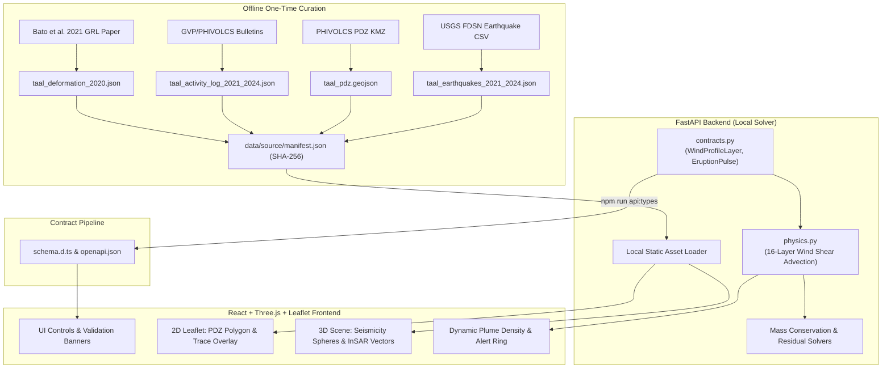

# ABO — Taal Implementation Plan (2026)

> **Document Origin & Basis:** This implementation plan is formally based on and derived from 'TAAL_FOCUS_QA_AND_DATA.md' (*ABO — Taal Focus, QA Status & Open-Source Data Report*, 12 October 2026). It operationalizes the recommendations, live QA findings, and open-source data curation workflow specified in that report.

---

## 1. Executive Summary & Alignment

This plan coordinates the software engineering, numerical physics modeling, offline data curation, and academic reporting required to fulfill the recommendations in `TAAL_FOCUS_QA_AND_DATA.md`:
1. **Focus on Taal Volcano as the Sole Scientific Target:** Demote Mayon and Kanlaon presets to explicit illustrative teaching scenarios in the UI and documentation.
2. **Offline Data Ingestion Architecture:** Enforce strict zero-runtime-network compliance by curating 2021–present observation datasets (USGS seismicity, PHIVOLCS PDZ, GVP/PHIVOLCS SO₂ and alert logs, Sentinel-5P TROPOMI, InSAR deformation) as local static assets with SHA-256 provenance tracking.
3. **Numerical Physics Enhancements:** Upgrade the Gaussian ash fallout solver to ingest 16-layer vertical wind shear profiles and multi-pulse eruption source terms.
4. **Validation Residuals & Visual Context:** Integrate model-observation residual comparisons against Balangue-Tarriela et al. (2022) and render 2D/3D contextual monitoring layers.
5. **Academic Rigor:** Maintain honest gap disclosure, separating verified numerical math from empirical eruption prediction.

---

## 2. Architecture & Data Flow



---

## 3. Phase 0: Environment Unblocking & Baseline Check

- **Action:** Move `C:\Users\Michael\.gemini\config\plugins\googlecloudtools.datacloud_telemetry` outside the `plugins/` directory to prevent hook crashes.
- **Verification:** Execute `uv run --project backend pytest backend/tests qa` and `npm run check` (in `frontend/`) to ensure all 164 Python tests and 61 Vitest tests pass cleanly.

---

## 4. Phase 1: Academic Scope Re-Orientation & UI Labeling

**Objective:** Prioritize Taal as the sole scientifically grounded case study and clearly distinguish it from teaching presets.

### 4.1 UI Controls & Disclaimers
- **Target File:** `frontend/src/components/Controls/VolcanoSelector.tsx` (and related preset selectors)
- **Modifications:**
  - Label **Taal** with a primary badge: `Validated Scientific Case (Balangue-Tarriela et al. 2022)`.
  - Label **Mayon** and **Kanlaon** with distinct badges: `Illustrative Teaching Preset — No Historical Validation`.
  - Add persistent contextual tooltips explaining that Mayon and Kanlaon utilize assumed teaching parameters and steady-state equations (Jeffreys lava flow), whereas historical field validation is confined to Taal.

### 4.2 Receptor Prioritization
- **Target File:** `backend/src/abo_core/` and municipal data loaders.
- Prioritize resolving the 52 unmatched Taal-domain municipal records rather than expanding Mayon/Kanlaon receptor inventories.

---

## 5. Phase 2: Offline Data Curation & Static Asset Integration

**Objective:** Curate 2021–present observational records as local static assets in compliance with the strict zero-runtime-network constraint.

### Directory Structure
```
data/
└── source/
    ├── manifest.json                        # Provenance: URLs, access dates, SHA-256 hashes
    └── taal/
        ├── taal_earthquakes_2021_2024.json  # Curated USGS seismic events
        ├── taal_pdz.geojson                 # Converted PHIVOLCS PDZ polygon
        ├── taal_activity_log_2021_2024.json # GVP/PHIVOLCS SO2, plume height, alert levels
        ├── taal_tropomi_july2021.json       # Sentinel-5P observed plume bearing/length
        └── taal_deformation_bato2021.json  # InSAR dike azimuth & uplift parameters
```

### 5.1 USGS Earthquake Catalog (2021–2024)
- **Source:** USGS FDSN API (`minlat=13.7`, `maxlat=14.3`, `minlon=120.7`, `maxlon=121.3`).
- **Processing:** Downloaded once offline, filtered to `type=earthquake`, formatted into `taal_earthquakes_2021_2024.json`.
- **Fields:** `time_utc`, `latitude`, `longitude`, `depth_km`, `magnitude`, `swarm_tag`.

### 5.2 PHIVOLCS Permanent Danger Zone (PDZ)
- **Source:** Official PHIVOLCS GIS Portal KMZ.
- **Processing:** Converted offline to GeoJSON (`taal_pdz.geojson`) using QGIS / GDAL.
- **Attribution:** Marked explicitly as an official institutional boundary, distinct from computed simulation outputs.

### 5.3 SO₂ Flux & Eruption Log (2021–2024)
- **Source:** Global Volcanism Program (BGVN volumes 46–49) and PHIVOLCS bulletins.
- **Fields:** `date`, `alert_level`, `so2_tonnes_day`, `plume_height_m`, `event_type`, `bulletin_ref`.
- **Target File:** `data/source/taal/taal_activity_log_2021_2024.json`.

### 5.4 Satellite & InSAR Ground Truth Context
- **Sentinel-5P TROPOMI:** Curate observed plume azimuth ($225^\circ$, length $\approx 85\text{ km}$, July 2021) in `taal_tropomi_july2021.json`.
- **InSAR Dike Emplacement:** Curate Bato et al. (2021) parameters (max uplift $\approx 1\text{ m}$, dike length $\approx 5\text{ km}$ toward SW) in `taal_deformation_bato2021.json`.

---

## 6. Phase 3: Backend Physics Upgrade — Vertical Wind Shear & Pulses

**Objective:** Upgrade the physical fallout solver to support height-dependent atmospheric wind profiles and multi-pulse eruption kinetics.

### 6.1 API Contract Expansion
- **Target File:** `backend/src/abo_api/contracts.py`
- Add schemas for vertical wind layers and piecewise eruption pulses:
  ```python
  class WindLayer(BaseModel):
      height_asl_m: float = Field(ge=0.0, le=40000.0, description="Altitude ASL in meters")
      speed_m_s: float = Field(ge=0.0, le=150.0, description="Wind speed in m/s")
      from_deg: float = Field(ge=0.0, lt=360.0, description="Meteorological wind-from azimuth in degrees")

  class EruptionPulse(BaseModel):
      start_offset_s: float = Field(ge=0.0)
      duration_s: float = Field(gt=0.0)
      mass_rate_kg_s: float = Field(gt=0.0)
      plume_height_m: float = Field(gt=0.0)
  ```
- Maintain full backward compatibility for existing scalar wind fields (`wind_speed_m_s`, `wind_from_deg`).

### 6.2 Physics Kernel Implementation
- **Target File:** `backend/src/abo_core/physics.py`
- Distribute vertical column mass across the 16 existing release layers.
- Apply layer-specific advection velocity $(u_x(z_k), u_y(z_k))$ derived from interpolated wind profile heights.
- Ensure analytic mass balance conservation is maintained:
  $$\sum_{k=1}^{16} M_k = \iint \sigma(x, y) \, dx \, dy + M_{\text{advected\_out}}$$

### 6.3 Contract Pipeline Synchronization
- Regenerate schema artifacts:
  ```powershell
  cd frontend
  npm run api:types
  npm run check
  ```

---

## 7. Phase 4: Frontend Visualization & Contextual Layers

**Objective:** Present the curated datasets and validation overlays in 2D Leaflet and 3D scenes without impacting client performance.

### 7.1 2D Leaflet Map Layering (`frontend/src/components/Map/`)
- **PHIVOLCS PDZ Layer:** Render official danger zone polygon with distinct institutional styling and attribution.
- **Historical Trace Comparison:** Display Balangue-Tarriela et al. (2022) 0.05 cm isopach contour alongside model predictions.
- **Residual Overlay:** Visual indicators showing spatial model over-prediction and under-prediction zones.

### 7.2 3D Scene Visualization (`frontend/src/components/ThreeScene/`)
- **Subsurface Hypocenters:** Three.js `InstancedMesh` spheres positioned beneath the Taal digital elevation model, colored by focal depth (shallow: red/orange; mid: yellow; deep: blue) and scaled by magnitude.
- **Seismic Swarm Playback:** Connect hypocenter visibility to the timeline scrubber to replay the July 2021 swarm.
- **Dynamic Plume Opacity:** Modulate particle billow opacity using curated $\text{SO}_2$ flux values.
- **InSAR Dike Vector:** Render a directional arrow in the caldera subsurface depicting the lateral dike intrusion path documented by Bato et al. (2021).

---

## 8. Phase 5: Verification, Validation Audit & Research Document Sync

**Objective:** Execute rigorous testing and synchronize findings with the IMRaD research manuscript.

### 8.1 Verification Checklist
```
[ ] Backend unit & physics tests: uv run --project backend pytest backend/tests qa
[ ] Ruff lint and formatting: uv run --project backend ruff check && ruff format --check
[ ] Frontend type & test checks: npm run check (in frontend/)
[ ] OpenAPI & contract drift: diff check on schema.d.ts
[ ] 30-minute memory soak: ensure Three.js mesh disposal and zero listener leaks
[ ] DOCX build: python scripts/build_research_document.py
```

### 8.2 Research Document Updates (`docs/ABO_RESEARCH_IMRAD.md`)
- Document the 16-layer vertical wind shear equations and multi-pulse kinetics.
- Detail the mass-density degeneracy and the Tanay radiosonde coverage limitation (71.43%).
- Record complete provenance, DOIs, and access dates for all 7 curated Taal datasets.
- Explicitly restate the boundary between numerical verification and scientific prediction.

---

## 9. Priority Schedule & Task Matrix

| Phase | Milestone | Primary Deliverable | Target Timeline |
| :--- | :--- | :--- | :--- |
| **Phase 0** | Unblock Environment | Clear telemetry hook; verify baseline test suite | Immediate |
| **Phase 1** | Scope Realignment | Relabel Mayon/Kanlaon presets; add Taal validation badges | Day 1 |
| **Phase 2** | Offline Data Curation | Ingest USGS earthquakes, PDZ GeoJSON, GVP activity log | Days 1–2 |
| **Phase 3** | Physics Upgrade | Implement 16-layer vertical wind shear in backend solver | Days 2–3 |
| **Phase 4** | UI & 3D Integration | Add PDZ layer, 3D hypocenters, and dynamic SO₂ plume opacity | Days 3–4 |
| **Phase 5** | QA & IMRaD Sync | Complete full verification suite and rebuild research paper | Day 5 |
